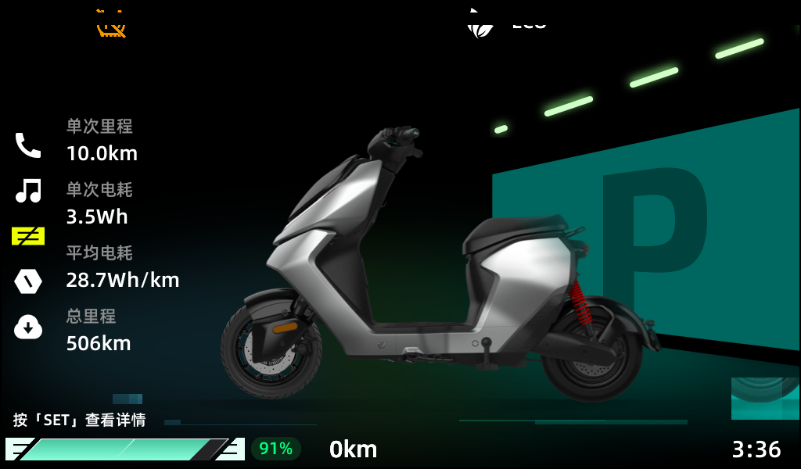

# Gemini-Dummy

### ZEEHO AE5i 仪表仿真器（QEMU）

> **Gemini-Dummy** = 在 QEMU 上复现 ZEEHO AE5i 仪表（Sunplus **SP8368 / GEMINI** + GD32 MCU）
> 的「空壳」工程：原厂内核 + 原厂 spapp 跑在模型里，MCU 侧由仿真对端代替。
> 名字取自 SoC codename **GEMINI**；Dummy 指「仪表本体被虚拟化」。

> 在 QEMU 上跑**原厂仪表固件**，用 MCU 仿真对端把整车数据喂进去，
> 让整机自己把 P 档主界面画出来 —— 画面 100% 来自固件自己的 QGraphicsScene，
> 没有任何离线合成 / 重绘 / 伪造像素。

```
┌──────────────┐   CFCP /dev/ttyS1@115200   ┌──────────────────────────────┐
│  MCU 仿真对端 │ ─────── TCP 127.0.0.1:9123 ──▶│  QEMU  sunplus-sp8368 (ARM)   │
│  tools/dash_up│ ◀──── ACK / 属性帧 ───────── │  ├─ 原厂 Linux 4.9.217 内核   │
└──────────────┘                            │  ├─ 原厂 spapp (Qt 5.3.2 仪表) │
                                            │  ├─ 模型: IPC stub / 3×fb /   │
                                            │  │        DMIX 追踪 / 帧导出  │
                                            │  └─ 原厂 PfcDispServer(PFC)   │
                                            └───────────────┬──────────────┘
                                                            │ 合成 framebuffer
                                                            ▼
                                              /tmp/ui-frame.ppm (1024×600)
```

**当前状态**：P 档主界面（整车 + 右侧茶青墙大 P + 绿地面 + 顶部绿光条 + 左列数据 +
底栏）已由固件自己渲染点亮，帧统计 **非黑 59.6% / 茶青 45%**。
样张：[`artifacts/dash_fw_real_vs_emu.png`](artifacts/dash_fw_real_vs_emu.png)（左实车 / 右仿真）。



---

## 1. 快速开始

> **前置输入**：`images/ae5i.spvd`（整机 flash pack，512 MB）与 `images/kernel-ae5i.bin`
> （原厂内核 uImage）。二者体积大且版权归原厂，`.gitignore` 默认不随源码分发，
> 需自备（见 §7）。没有它们 QEMU 起不来。

```bash
cd Gemini-Dummy

# 1) 编译 QEMU 模型（macOS 注意：必须用这个脚本，它会 codesign 并同步产物）
python3 tools/build_model.py

# 2) 起仿真器（前台会阻塞；建议放后台或另开终端）
bash run_ui.sh
#    串口日志 → /tmp/ui-serial.log     帧导出 → /tmp/ui-frame.ppm
#    QEMU monitor → /tmp/ui-mon.sock    CFCP 桥 → 127.0.0.1:9123（单连接）

# 3) 用 MCU 仿真对端把仪表点亮（ACK 每帧 + 上电 + 解锁 + 挡位 + 全量数据）
python3 tools/dash_up.py --duration 20 --png /tmp/out.png
```

`dash_up.py` 会自动完成三段进场（见 §4.3），退出前画面保持；加 `--duration 0` 常驻。

常用参数：

| 参数 | 默认 | 说明 |
|---|---|---|
| `--gear` | 1 | 挡位，1 = P 档主界面 |
| `--soc` | 91 | 电量 % |
| `--odo` / `--avg-power` | 5060 / 287 | 总里程(0.1km) / 平均电耗(0.1Wh·km⁻¹) |
| `--trip` / `--trip-power` | 100 / 35 | 单次里程(0.1km) / 单次电耗(0.1Wh) |
| `--range` | 0 | 续航 km（**非 0 会残影**，见 §6.3） |
| `--amb-temp` | 25 | 环境温度 ℃（prop 已对，widget 显示条件未解） |
| `--drive-mode` | 1 | 1=ECO 2=STREET 3=SPORT |
| `--rtc` | auto | `auto`=跟随宿主机本地时间；`none`=不喂 |
| `--lamps` | 空 | 指示灯位图 16B hex（见 §5.4） |

只想看帧统计：`python3 tools/cfcp_probe.py --frame`。

---

## 2. 这个项目在做什么（以及不做什么）

**做**：把原厂仪表固件当成黑盒，在 QEMU 里复现它依赖的 SoC 环境（IPC 邮箱、显示图层、
CFCP 串口），然后用 MCU 仿真对端按真实协议喂数据，让固件自己渲染。

**不做**：
- 不修改固件、不修改内核（内核必须保持原厂，见 §7）；
- 不照着实车照片重绘任何像素 —— 画面里的每一个像素都必须是固件自己画的；
- 不提取 / 外传固件里的厂商云密钥。

历史上有过「用 PIL 拼一张背景图喂给 framebuffer」的做法，**已全部作废并删除**，
现在 `Gemini-Dummy/assets/` 不存在，仓库里没有任何合成产物。

---

## 3. 目录结构

| 路径 | 内容 |
|---|---|
| `qemu-src/` | QEMU 源码树 + 自建 `sunplus-sp8368` 机器模型（`hw/arm/sunplus-sp8368.c`，4.8k 行） |
| `images/` | `ae5i.spvd` 整机 flash pack（512 MB）+ 原厂内核 `kernel-ae5i.bin` |
| `tools/` | 仿真器工具链（MCU 对端、反汇编器、探针）—— 见 §5 |
| `docs/` | 全部技术文档，入口 [`docs/README.md`](docs/README.md) |
| `tests/` | GPU 2D / CFCP 协议回归 |
| `flutter_app/` | macOS 图形客户端（可选；也能直接看 PPM） |
| `artifacts/` | 渲染样张 |
| `patches/` `firmware/` `logs/` | 历史输入材料与只读基线 |

---

## 4. 已验证的技术结论

### 4.1 显示栈与「花屏」根因

- 显示路径是 **PFC / VPP / DMIX** 混合器 + 3 个 fb 窗口：
  window0 = Qt OSD，window1 = 背景层，window2 = 备用；`sp_fb_dump()` 负责合成导出。
- 这个 Qt QPA 是 **增量绘制 + 双缓冲**：每帧只重画变化的那几块，**从不重画背景**，
  它依赖后沿缓冲里已经有上一帧的内容。
  ⇒ 模型在 IPC cmd 6（`_ipc_swapbuf`）翻页时必须做 **整页 copy front → back**。
  缺了这一步，后沿停留在更旧的画面 ⇒ 文字重影、图标叠成双份、动画拖尾。
  证据：`monitor pmemsave 0x0C000000` 出来的 OSD 页里就带着残影；
  `tools/entry_probe.py --mode early` 能抓到同屏 6 份整车拷贝。
- 内核侧 IPC 契约（`kernel-ae5i.bin` → vmlinux → `tools/kdis.py`）：
  - `rpc_isr`：应答 dword2 **bit15=1 → 拷回 waiter 的 msg 并唤醒**；bit15=0 → 用户态 fifo；
  - `IPC_FunctionCall`：返回值 = 应答 `msg+0xa & 0xFFF`。

### 4.2 CFCP（MCU ⇄ SoC）链路

- 物理层 `/dev/ttyS1 @ 115200`，模型桥接到 `127.0.0.1:9123`（**同一时刻只容一个客户端**）。
- 帧格式：`FE5AAA5 | f0 | f1 | cmd(4 LE) | len(2 LE) | data | chk | A5555A`，
  属性帧 `f0=0x11 f1=0x02 cmd=0x00010175`，属性载荷 `[inner u16][prop u32][sub u32][value]`。
- **对端必须 ACK 每一帧**（固定 16 字节 `fe5aaaa59008550101000000 10a5555a`）。
  不回 ⇒ guest `cfcp_ack_q_work_handl ... resend_times is 3` 重传丢弃 →
  「应用层拿不到属性」→ 仪表永远停在待机页（4.37% 非黑）。**这是最容易被忽略的坑。**

### 4.3 点亮 P 档主界面的三段式进场（唯一稳妥顺序）

```
⓪ pre-arm : App 还没画第一屏时，只喂 KL15 + RTC —— 绝不能带解锁通知
① settle  : 连发 20 拍全量数据，挡位固定 0（不进 P 档，不触发场景动画）
② enter   : 只写一次挡位 = 1 → 场景机切 PGEAR → 等动画跑完
```

踩过的坑（都写进 `tools/dash_up.py` 注释与 `docs/EMULATION.md §42`）：
- pre-arm 带解锁 ⇒ 闸门提前打开，挡位在 App 初始化中生效，动画被拆成 6 帧 ⇒ **整车拖尾**；
- 挡位反复写 ⇒ 每次都重摆顶部 DRL/ECO 两个 item ⇒ **图标叠成双份**；
- 进场后才改数字 ⇒ 数字 item 只重画自己新文本的矩形，`0km→100km` 变宽 ⇒ 旧 `0` 残留（`000km`）。

### 4.4 场景状态机（`libdashclustoractivity.so`）

```
Animation_Setinit(sence)      // state=this+0x70c, 当前场景=this+0x704
  state 0: sence 1 → Animation_Mstart_init()  → DASHobj_showInit(true)   (统计页)
           sence 2 → Animation_Pstart_init()  → PGEARobj_showInit(true)   (P 档主界面)
```
`PGEARobj_showInit(true)` = 给 9 个 item `setOpacity(1.0)`（茶青墙大 P / 整车 / 绿地面 / 绿光条…），
位置由 item 创建时确定。

`slot_delayUpdateGear()` 开头有一道**硬闸门**：
`sysState.byte[1] & 0x40`（`MCU_SIGNAL_UNLOCK_NOTIFY`）为 0 就直接 return ——
不解锁则换挡、换场景全部无效。

### 4.5 MCU 上行属性表（逆向 + 实测双向确认）

| prop | handler | 长度 | 布局 |
|---|---|---|---|
| `0x21400030` | KL15_STATE | 4 | `0x99`=整车就绪点亮 / `0x55`=待机 |
| `0x21709606` | synchronization_status | 8 | `[1] bit2` = UNLOCK_NOTIFY ★闸门 |
| `0x2170951d` | vehicle_info2 | 24 | `[0..3]remaind_fuel `[4]gear` `[8..11]remind_milage` `[12..15]batt_12v_voltage` `[16..19]ambTemperature` |
| `0x2170952d` | vehicle_info3 | 20 | `[1]drive_mode `[2]battery `[3][4]motor_temp `[6..7]power_num `[11..12]voltage` |
| `0x21707402` | vehicle_info1 | 20 | `[0..3]wheel_spd `[4..7]inst_elec` `[12..15]rpm` `[16..19]water_temp` |
| `0x21707401` | trip_total_ODO | 24 | `[0..3]odo(0.1km) `[8..11]avg power(0.1Wh/km)` |
| `0x21700003` / `0x21700004` | trip_1 / trip_2 | 24 | 同上（单次里程/电耗） |
| `0x21709600` | power_battery | 16 | `[0]lvl1 `[1]lvl2 `[2]all = 电量% |
| `0x21707121` | RTC_report | 6 | `[yy,mm,dd,hh,mi,ss]` |
| `0x2170951e` | indicator_lamp | 16 | 指示灯位图（byte0 bit0 = `ABS_off`，byte1 = `ABS_fault` 会弹故障框） |

**发现方法（可复用）**：喂「第 i 字节 = i」的身份载荷，handler 会把解析出的字段打进
日志（`vehicle_info2.gear : 4`、`indicator_lamp.ABS_off 1`），偏移一次问出来；
长度不对时 handler 打 `size erro, size=N`，据此二分即可。

---

## 5. 工具清单（`tools/`）

| 工具 | 作用 |
|---|---|
| `dash_up.py` | **MCU 仿真对端（主力）**：ACK 每帧 + 上电序列 + 解锁 + 三段式进场 + 全量数据 + 自愈 |
| `cfcp_probe.py` | CFCP 探测台：`--frame` 帧统计、`--sweep A:B` 扫 prop、`--lit` 点亮 |
| `probe_prop.py` | 单 prop 身份载荷探针（问出字段偏移） |
| `entry_probe.py` | 进场策略 A/B（`single` / `early` / `dual` / `quad`），抓拖尾与残影 |
| `lamp_probe.py` | 指示灯位 → 屏幕图元 bbox 映射 |
| `lamp_bits.py` | indicator_lamp 全部位定义（单 bit 载荷 + 日志 diff） |
| `bg_probe.py` | PFC/DOV 背景层探针（`get dov failed` 次数、window1/2 像素统计） |
| `fb_diag.py` | 通过 monitor 读 guest framebuffer / fb 注册链 |
| `guest_shell.py` | 起一个带串口 shell 的 guest，执行命令取证 |
| `guest_mem.py` | 读 guest 物理内存（`PA = VA - 0xC0000000`） |
| `sores.py` | **.so 反汇编器**：解 Thumb PLT → GOT → dynsym 符号名（所有调用图靠它） |
| `kdis.py` | 内核 ELF 反汇编（按 PT_LOAD 做 VA→file 映射） |
| `arm_disasm.py` | 通用 ARM/Thumb 反汇编 + `--callers` 调用者扫描 |
| `xcaller.py` | 通用 `bl/blx` 调用者扫描 |
| `build_model.py` | 编译模型并把 unsigned 产物 codesign 后同步到 `build/qemu-system-arm` |
| `vhal_probe.py` `mcufeed_sweep.py` `cfcp_key.py` `nand2spvd.py` | vhal 信封 / 批量喂帧 / 密钥协商 / NAND→SPVD |

### 5.1 模型环境变量（`SP_*`）

| 变量 | 作用 |
|---|---|
| `SP_IPC_STUB=1` | 打开 SoC IPC 邮箱桩（必须） |
| `SP_IPC_MODE=0\|1\|2` | 回包策略：0=只内核 / 1=只用户态 / 2=内核+用户态副本（**别用 1**，见 §6.2） |
| `SP_FB_MULTI=1` `SP_FB_COMPOSITE=1` | 暴露 3 个 fb 窗口 / 按层合成导出 |
| `SP_FB_FRAME=<file>` | 实时帧导出（内容去重，按需重写） |
| `SP_FB_TRACE=1` | 打印 fb 扫描页切换（IPC cmd 6） |
| `SP_FB_NO_FLIPCOPY=1` | 关掉翻页复制（做 A/B 对照用） |
| `SP_PFC_TRACE=1` `SP_VPP_TRACE=1` | 打印 PFC/DOV/VPP 寄存器与 IPC 载荷 |
| `SP_VDISK=<spvd>` `SP_VDISK_BASE=0x50000000` | 把整机 flash pack 当作 flash 设备挂给 guest |
| `SP_RAM_DUMP=<file>` | guest RAM 快照（取证利器） |

完整列表见模型源码 `grep -o 'getenv("SP_[A-Z0-9_]*")' qemu-src/hw/arm/sunplus-sp8368.c | sort -u`。

---

## 6. 已知限制

### 6.1 右下角一小块残影（进场动画首帧）

约 94×70 px，位于 (930..1024, 470..540)，内容是整场缩小版（茶青墙角 + 车轮）。
成因：进场动画把整场从右下角小尺寸放大/滑入，**首帧的像素没有任何后续绘制覆盖**，
而固件不会清屏。真机上它由 `libpfc_service` 的 `BackGroundFlipThread`（每帧重贴背景）擦掉。

### 6.2 PFC/DOV 背景层没打通

固件自己的 `PfcDispServer` 在跑、也拿到了 `get_bg_info Background W/H: 1024/600`，
但查 DOV 图层配置失败：`PFC_DOV : get dov failed`（IPC id=0x17，len=14，subcmd=0x54e1；
`dov_send_cmd` 收包后读 `msg+0xc`，非 0 即判失败）。
模型目前只能伪造回包，做不到「转发请求 → 等 daemon 回包 → 按 bit15 送回 waiter」。
试过 `SP_IPC_MODE=1`（只回用户态）：失败次数 3→1，但 id=3（fbdss 取 UI 分辨率）用的是
内核侧等待者，只回用户态会让整个显示栈停摆（串口刷 `RPC SERVER #7 NOT RUNNING!`）⇒ 已回退。

**打通它，§6.1 的残影会随「每帧重贴背景」自然消失。**

### 6.3 一些数据项显示不出来

- **续航 km**：prop 已对（`remind_milage`），但非 0 时底栏数字位会残影（固件只重画新文本矩形）。
- **环境温度 ℃**：prop 已对（`ambTemperature`），P 档主界面不上屏，显示条件未解。
- **顶部指示灯**：固件从不擦除旧像素，灯只能加不能减 ⇒ 默认不喂。
- **总里程/平均电耗以外的行程统计**：部分字段还没逐个解。

---

## 7. 合规红线（参与前请读）

1. **只允许原厂内核**：不得修改内核源码，不得刷改固件；一切改动只发生在 QEMU 模型侧与工具侧。
2. **厂商密钥绝不外传**：`libvehiclesignalmodule.so` 内含厂商云密钥，禁止拷贝/上传/引用。
3. **固件与镜像的版权归原厂**：仓库里的 `images/*.spvd`、`images/kernel-*.bin` 仅供本地复现，
   对外分享前请自行确认授权范围；**建议对外只分享模型与工具，不重新分发镜像**。
4. **禁止伪造画面**：所有渲染产物必须来自固件自身；不要用绘图库拼图冒充固件输出。
5. **刷机/救砖操作只能由车主本人执行**（U-Boot、串口 DTR/RTS 复位等）。

---

## 8. 可以一起做的课题（欢迎认领）

| 方向 | 难点 | 现状 |
|---|---|---|
| **PFC/DOV 图层引擎** | 需要在模型里实现一次真正的用户态 IPC 往返 + 图层混合 | §6.2，协议已解一半 |
| **背景层 wallpaper** | 需要解出 `libpfc_service` 从 NAND 取壁纸并写进 DOV 平面的路径 | §34/§40 |
| **指示灯位图全表** | `indicator_lamp` 128 位逐个解 + 图元对应 | 已解 3 位（§5.4） |
| **续航/温度 widget** | 显示条件（哪个状态机分支决定可见性） | prop 已对，条件未知 |
| **按键 / 车身模型** | 11 个 KeyID、转向灯、ABS 等 | 见 `docs/EMULATION.md §23` |
| **OTA Update 仿真** | 分区表、校验、断点续传、失败恢复 | 见 `docs/EMULATION.md §37` |
| **Windows/Linux 化** | 目前仅 macOS 验证（codesign/HVF 依赖） | 只在 macOS 上跑通 |

---

## 9. 文档索引

| 文档 | 内容 |
|---|---|
| [`docs/README.md`](docs/README.md) | 全部文档索引 + `EMULATION.md` 章节地图 |
| [`docs/EMULATION.md`](docs/EMULATION.md) | 主线工程日志（42 章，从启动链到花屏收尾）—— **主文档** |
| [`docs/KERNEL-DISPLAY-RE.md`](docs/KERNEL-DISPLAY-RE.md) | 内核显示栈逆向：符号恢复、IPC 契约、DMIX/VPP |
| [`docs/MCU-DATA-FEED.md`](docs/MCU-DATA-FEED.md) | MCU 上行数据仿真进展 |
| [`docs/SUNPLUS-MEMMAP.md`](docs/SUNPLUS-MEMMAP.md) | SoC 内存图 / fb 窗口布局 |
| [`docs/BACKEND-DESIGN.md`](docs/BACKEND-DESIGN.md) | 客户端后端设计 |
| [`docs/NAND-150AURA.md`](docs/NAND-150AURA.md) | NAND 几何与历史对照平台 |

---

## 10. 许可与致谢

- 模型代码、工具、文档：本仓库自有，可自由取用。
- QEMU 本身遵循其上游 GPLv2 许可；本仓库只包含**新增的机器模型**与探针。
- 感谢 ZEEHO AE5i 仪表固件作者 —— 本项目的全部画面与数据都来自他们的实现。
